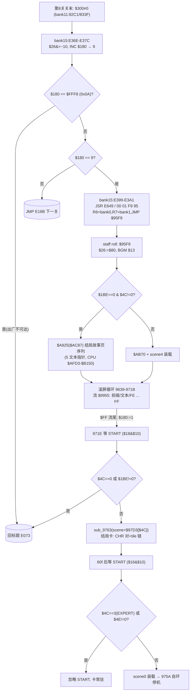

# A3 结局段取证 — 通关触发链 / staff roll→结局卡流程 / 三结局分支 / 结局卡机制

> 任务：三难度结局的触发链/差异/staff roll→结局卡流程。产出=本文件（增量落盘）。
> 语义口径：九班=美版基底（D3①）；JP=语义权威参照（坐标桥 `data/reference/addr-bridge-jp-cn.json`，
> 本文件 JP 点位全部为**字节模式验证**，未手工换算）；死亡链已定谳（game-over-continue.md）。
> 证据分级依 AGENTS.md §3。结论/假设分区；假设不入结论。
> 【坐标换算注】"file"=含 16B iNES 头的文件偏移（file=PRG+0x10）；bankNN:AAAA=8KB PRG bank 号:CPU 地址
> （bank00/01 映 $8000/$A000，bank15=固定 $E000，bank14 常驻 $C000）。

## 0. 结论速览（TL;DR）

| # | 结论 | 级 |
|---|---|---|
| 1 | **通关判定**：关末序列（`bank15:$E2FC` 块，`$26 bit4` 门）等待 `$0300≠0` 后 `INC $0180`（`bank15:$E37C`）；`$180==9`（第 8 关打完）→ `JSR $E649` 内联分派 `00 01 F9 95` = **R6←bank0/R7←bank1 + JMP $95F9** = 结局段入口 | A |
| 2 | `$FFF8`（ROM 尾标志，file 0x20008，三版均 =**0x0A**）为"提前终局哨兵"：`INC $180` 后 `$180==$FFF8` → 直回标题（跳过 staff roll）；出厂 0x0A>9 ⇒ **永不触发**（休眠调试位） | A |
| 3 | **staff roll** = `bank00:$95F9-$971B`：开场（BGM $13）→ 前置场景（`$A925($AC87)`=结局故事页序列 or `$AB70`+scene4）→ 滚屏循环（流指针 `$2F:$30:=$9955`，每循环发 1 条记录）→ 流尾 `$FF` → `$0180:=1` → 等 START | A |
| 4 | **staff roll 文本流格式**（`$9955` 起，bank0 CPU $9955-$9BCC，file 0x1965-0x1BDC）：`[位置前缀(<$20)] ASCII… FE(行事件) … FF(流尾)`；`$FE`=记录分隔（无渲染）、`$FF`=流结束；与社区"位置字节+行事件"格式互证 | A |
| 5 | **结局卡出现流程**：staff roll 尾 `971E` 等 `$18&$10`（START）→ `$4C==0` 或 `$1BE≠0` → 回标题；否则 `A:=$97D3[$4C]` → `sub_9763`（场景装载器，8 字节场景记录）→ 60 帧后等 `$16&$10`（START 边沿）→ `$4C==3` 或 `$4E≠0` 时 **START 无效（卡常驻）**；否则装 scene0 后 975A 自环（停机待复位） | A |
| 6 | **三/四结局分支条件定谳 = 难度（GAME LEVEL）**：`$4C` = GAME LEVEL 索引（0..3 = NOVICE/INTERMEDIATE/ADVANCED/EXPERT，UI 显示 1-4），默认 1（INTERMEDIATE，`bank15:$E04D`）；**结局卡场景 = `$97D3[$4C]`**（表 `00 01 02 03`）⇒ $4C=1/2/3 各一张卡（scene1/2/3），**$4C=0（NOVICE）无结局卡**（直接回标题）——与社区"三张结局卡"数目吻合 | A（选择链）/B（数目对账） |
| 7 | **结局文本≠分支**：美版结局故事文本块（file 0x2FE3-0x3150，CPU $AFD3-$B150）是**同一份连续故事的 4 个 `FF` 页**（`23 26` 头、4 行/页、页间不换 PPU 落点），非多结局文本；JP 同区为 5 页/3 行布局（翻译重排） | A（字节结构）/B（"同一故事"=文本连读判读） |
| 8 | **结局卡图形差异 = CHR 对 + nametable 块 + tile 块链**：scene1(`$5E/$5C`,基址$C0D2,链$9855) / scene2(`$22/$20`,基址$BB4E,链$9885) / scene3(`$22/$20`,基址$BB4E,链$98F3)——scene2/3 同 CHR 不同 tile 链；scene0(`$2E/$2C`) = 卡后收尾屏 | A（记录字节）/B（字段语义） |
| 9 | 双版：通关/结局链 bank15 段 **US==CN 逐字节全等**（0x1E366-0x1E3B0 实测）；JP 同链同构（bank15 +0x0A 一致漂移系，同 game-over-continue §5）；JP 设置屏同为 4 难度（ノービス/ミドル/アドバンス/エキスパート）；**JP 无难度削减** | A |
| 10 | **H7 定谳：`TOOL & CONVERTER SIIPU.RA.SU. TAKA / POCHI (CYBER) NAKAMORI` = 美版构建自带署名行**（TAKA/POCHI/NAKAMORI 在 US 同字节位；`SIIPU.RA.SU.`=九班把 US 假名/徽标 tile 换成 ASCII 罗马字；九班另插 `@2011 JIUBAN` 水印） | A |

---

## 1. 通关触发链（验收①）

### 1.1 关末序列（stage-clear block）— A 级代码链

主循环（`bank15:$E29A`，死亡链已证）每帧：`$0400≠0` → `E2F3`。`E2F3: LDA $26 / AND #$10 / BNE E2FC`——
**`$26 bit4` = 关末（stage-clear）进行位**；置位进入关末序列，清位走 `JMP sub_E21C`（帧服务）。

```
bank15:E2FC  LDA $27 / ORA #$80 / CMP $27 / BEQ E328   ; 一次性入场（$27 bit7）
bank15:E304  LDY $400 / BEQ E2F9                       ; 等玩家对象存在
bank15:E309  STA $27                                   ; $27|=$80
bank15:E30B  LDA $26 / BPL E312 / JMP loc_E073         ; $26 bit7（模式位）→ 直回标题
bank15:E312  $2F:=$32(50) / $188:=$7E / $300:=0 / 音效$10
bank15:E328  LDA $2F / BEQ E345                         ; 倒数（每 8f DEC，尽→$41C:=$A4,$438:=$0D 飞离向量）
bank15:E32C  $06A0:=2                                   ; 关末免死保护（死亡链 §1.3 已证）
bank15:E345  LDA $180 / CMP #4 …                        ; 第 4 关特判（$82/$83→$64，滚动参数，语义开放）
bank15:E366  LDA $300 / BNE E36E / JMP sub_E21C         ; ★等 $0300≠0（bank11:$82C1/$833F 写点=飞离动画完成）
bank15:E36E  $26 &= ~$10                                ; 清关末位
bank15:E374  LDA #4 / JSR $EE03 / JSR $ED56             ; 淡出/音乐
bank15:E37C  INC $180                                   ; ★关号 +1
bank15:E37F  LDA $180 / CMP byte_FFF8 / BNE E392        ; ★与 ROM 尾标志比
bank15:E387  (== $FFF8) LDA #2 / JSR $EE03 / JSR $DB14 / JMP loc_E073   ; 提前终局→标题
bank15:E392  CMP #9 / BEQ E399                          ; ★通关判定：$180==9
bank15:E396  JMP loc_E16B                               ; 否则→下一关（关间跳转，不经 E0D9 顶部）
bank15:E399  LDA #2 / JSR $EE03 / JSR $DB14             ; ★通关支
bank15:E3A1  JSR $E649 / db 00 01 F9 95                 ; ★bank 分派：R6←0(bank0@$8000) R7←1(bank1@$A000), JMP $95F9
bank15:E3A8  JMP loc_E073                               ; （$95F9 不返回；此为回退路径）
```

- **字节级复核**（PRG 0x1E366-0x1E3B0 hexdump 与上表逐字节一致，A 级）。
- `$E649` 内联调用约定（`sub_E649/sub_E672`，bank15:$E649-$E68F）：`JSR` 返回址-1 → +4 跳过 4 字节内联参数；
  参数解码：`[+1]→sub_E61F`（MMC3 R6 写）、`[+2]→sub_E62E`（MMC3 R7 写）、`[+3,+4]→JMP ($24)` 目标。
  ⇒ `00 01 F9 95` = **R6:=$00、R7:=$01、JMP $95F9**（A 级：逐指令 + 与 game-over-continue §5.1
  `$E3A4` 内联参数流勘误互证）。
- **`$FFF8` = file 0x20008 = 0x0A**（CN/US/JP 三版同值，A 级 hexdump）。语义=提前终局哨兵（调试位）：
  出厂 0x0A > 可达最大值 9 ⇒ 死代码路径；`$FFF9`（0x00，隐藏选项门）同居向量前区（hidden-option-gate-fff9.md）。
  注意 **$FFF8 与 $FFF9 是两个不同标志**（前者=终局哨兵，后者=隐藏选项门），勿混。
- `$0300`（关末推进闸）写点仅 3 处：`bank11:$82C1/$833F`（置非零=飞离/关末动画完成事件）+ `bank15:$E2D7/$E31D`（清零）。
  其上游（谁/何时置位）= B 级（bank11 关末动画对象族，未逐指令展开）。
- `$26 bit4` 置位点 = `bank00:$8D02-$8D06`（`ORA #$10 / STA $26`）——**最终 BOSS 击杀/波次链完成事件**的
  上游入口（bank00:8D00 前置条件分支），B 级（调用图级）；`bank15:$E1B8` 开局 `AND #$80` 清位、`E36E` 关末清位。

### 1.2 "八关打完→结局"判定（A 级）

- `$0180` = 关口号：开局 1（`bank15:$E04A`/`bank00:$8F6D`）、关末 INC（`$E37C`）。
  **`INC $180` 后 `$180==9` ⇒ 第 8 关清完 ⇒ 通关支 `$95F9`**。无第 9 关（`CMP #9/BEQ` 是唯一出口比较；
  `loc_E16B` 关间装载按 `$180` 取关数据，最大值被 `$FFF9` 门的 `bank15:$E08E` 钳制族约束（hidden-option §2））。
- 衍生：`bank00:$8F7C-$8F8A`（`JSR $EC12 / AND #3 / ADC #1 / STA $180 / $26|=$80`）= **关卡直跳（调试）**：
  $26 bit7 置位后死亡/关末均直回标题——与 game-over-continue §3.4 模式位注合流（C 级语义维持）。

**通关触发链验收①：A 级（代码链逐字节+内联分派解码+$FFF8/$FFF9 双标志区分）+ B 级（$26 bit4/$0300 上游事件归属）✓**

---

## 2. staff roll 流程（验收② 上半）

### 2.1 入口 `bank00:$95F9`（A 级）

```
bank00:95F9  LDA #$80 / STA $26              ; $26:=$80（bit7 模式位：死/关末直回标题）
bank00:95FD  JSR $E590 / $E7FB / $EED7 / $E567   ; 场景服务装载
bank00:9609  LDA #$13 / JSR $ED3B            ; 音效/乐曲 $13（staff roll BGM）
bank00:960E  LDA $1BE / BNE 9617             ; $1BE（设置字段）≠0 → 前置场景 A
bank00:9613  LDA $4C / BNE 9625              ; GAME LEVEL≠0 → 前置场景 B（结局故事）
bank00:9617  JSR $AB70 / $E7FB / LDA #4 / JSR sub_9763   ; 前置 A：scene4 装载
bank00:9625  LDA #$87 / LDY #$AC / JSR $A925             ; 前置 B：$AC87 结构（结局故事页序列）
```

- **`$AC87`（bank1）= 结局故事页序列**：结构内 5 个文本指针 `$AFE4/$B04B/$B0A6/$B0FD/$B149`
  （xref 全 ROM 唯一来源=本结构，PRG 0x2C91/0x2C99/0x2C9F/0x2CA5/0x2CAC，A 级指针检索），
  全部落在结局文本块（CPU $AFD3-$B160）内。`$A925(A,Y)`=页序列装载/播放器（含等待参数 `01 50/01 64` 族），
  其记录格式逐字段语义= B 级（未闭环，残项 R-E3）。
- `$1BE` = 设置字段（CONTROL ROOM 第 6 字段，见 §4）；≠0 时走 scene4 支（`$97F7` 记录）。
  两支的**可见差异**（故事文本 vs 图形屏）= B 级推断（未动态采证）。

### 2.2 滚屏循环与文本流（A 级）

```
bank00:962C  $408:=$75 / $2F:=$55 / $30:=$99        ; ★流指针 $2F:$30 := $9955
bank00:9639  LDY #4 / JSR $ED30                     ; 4 帧节拍
bank00:963E  DEC $40A / BMI 9649                    ; 行事件计数
bank00:9643  DEC $408 / JMP 9639                    ; 滚动步进（$408/$40A/$409/$406/$407 = 滚动/相位参数）
bank00:9649-96D4  ($409 0..0x1D 循环、$10/$11/$14/$15 计算 = 卷轴/相位推进；每 2 拍写 $14/$15)
bank00:96D6  LDY #0 / LDA ($12),Y / BPL 96E9         ; 读流字节
             BMI 段: INY / CMP #$FE / BEQ 970F       ;   $FE → 记录分隔（跳过）
                     LDA #1 / STA $180 / JMP 971E    ;   ★$FF → 流尾：$180:=1 → 结局卡等待
bank00:96E9  INY / CMP #$20 / BCC 9706               ; < $20 = 位置前缀字节
             ≥ $20: 渲染字符（$14 偏移 (ch&$1F)、JSR $E6DF 出字）
bank00:970F  流指针 $2F/$30 += Y / JMP 9639          ; 每循环消费一条记录
```

- **流格式（A 级字节+读者双向）**：`[位置前缀($00-$1F)] ASCII 0xFE … 0xFF`。前缀字节=行内定位/跳格参数
  （`9706: ADC $14 / ORA #$20 / STA $14 / JSR $E6DF`，B 级精确语义）；`FE`=记录分隔；`FF`=流结束。
- **CN 流 43 条记录全文**（前缀 hex 省略，`/`=FE）：COMPILE STAFF / GAME DESIGN & PROGRAM /
  D.M.A.BISU JEMINI / BILLIARDS MIZUTA / GRAPHIC DESIGNER / HEAVY SLEEPER JANUS / PAPAGENA ANEGO /
  MUSIC / GOLFER SAKODA / SOUND EFFECT / MATS / SPECIAL THANKS / TOOL & CONVERTER /
  SIIPU.RA.SU. TAKA / POCHI (CYBER) NAKAMORI / COORDINATER / MOO NIITANI / TOKYO SHOSEKI STAFF /
  ORIGINAL PLAN / M.AZUMA / DIRECTOR / ASTINA MATSU / DESIGNER / K.YANO / YOKORIN / Y.KANEKO /
  TECHNICAL SUPPORT / MIYATAN / YOSSHA MATSU / SPECIAL THANKS TO / EMARIN / KUSUKE / H.SHIBATA /
  KAZO OYAMADA / KANTA.U / YAKO PIAPIA / PRODUCER / IKURO URAI / COMPILE / AND / TOKYO SHOSEKI /
  PRESENTED BY NEXOFT CORP. / @2011 JIUBAN → `FF`。
- 流实址 **CPU $9955 起（file 0x1965）**；rom-forensics 版面 0x01959-0x01BC0（file）与本流区重合 ✓
  （其 `{1B 前缀,文本,FE}` 观察=本格式的记录视角，互证）。
- 社区互证："staffroll 独立格式：位置字节+行事件"、"43 条记录/168 行"、"32B 打包防 PPU 队列超限"
  （`$E828` 预算门族，t94/t117）——格式结构一致 ✓；**43 条记录本版实数吻合（R-E1 收口）**：
  CN 流解码恰 **43 条 `[前缀]文本` 记录**（COMPILE STAFF → @2011 JIUBAN 全列见 §5.3 语境）+ 段间 `FE` +
  流尾 `FF`。行数（社区 168 行=其 text.csv 工作表行数）口径不同，不强行对账。

### 2.3 staff roll → 结局卡衔接（A 级）

流尾 `$FF` ⇒ `$0180 := 1`（重置关号，防复位误判续关）→ `bank00:$971E`。

**验收②上半（staff roll）：机制/格式/结束条件 A 级定谳 ✓**

---

## 3. 结局卡流程（验收② 下半 + 验收④流程图）

### 3.1 结局卡调度 `bank00:$971E-$9760`（A 级，原始字节复核 PRG 0x171E-0x1770 一致）

```
971E  JSR $ED27 / JSR $E5D9                      ; 帧服务+输入
9724  LDA $18 / AND #$10 / BEQ 971E              ; ★等 START（$18 位 $10）
972A  LDY $4C / BEQ 9760                         ; ★GAME LEVEL==0 → JMP $E073（无结局卡，回标题）
972E  LDA $1BE / BNE 9760                        ; $1BE≠0 → 回标题
9733  SEI
9734  LDA $97D3,Y                                ; ★结局卡选择表 $97D3 = 00 01 02 03
9737  JSR sub_9763                               ; ★场景装载（A=场景号）
973A  LDY #$3C / JSR $ED30                       ; 60 帧
973F  JSR $ED27 / JSR $E5D9
9745  LDA $16 / AND #$10 / BEQ 973F              ; ★等 START 边沿（$16 位 $10）
974B  LDY $4C / CPY #3 / BEQ 973F                ; ★GAME LEVEL==4(EXPERT) → 忽略 START（卡常驻）
9751  LDA $4E / BNE 973F                         ; ★$4E≠0 → 忽略 START（$4E=子弹反弹设置，见 §4）
9755  LDA #0 / JSR sub_9763                      ; 装 scene0（收尾屏）
975A  JSR $ED27 / JMP 975A                       ; 自环（停机待复位/断电）
9760  JMP $E073                                  ; → 标题
```

- 社区注"结局卡在 staff roll 后按 START 出现"✓（`971E` 等待）；"结局卡 IRQ 延迟 16px+底部滚动校正"
  对应 bank1 `$ACD8` 族 IRQ 边界修正（community §2.2）——**IRQ 延迟数值本版未独立复核**（残项 R-E2）。
- `sub_9763`（`bank00:$9763-$97D2`）= 场景装载器：清屏（`$E601`/`$E8B1` 填 $2040 起 $2C0B）→ 8 字节场景记录
  （`$97D7 + A*8`）逐字段解码（§3.2）→ `$EBC2` 链执行 → `LDA #4 / JMP $EDB0`。
- `$EBC2(A,Y)`（bank15）= **8 字节记录链分派器**：`{handler_lo handler_hi, args→$10..$15}`，handler=0 终止；
  每条 `JMP (handler)`，处理后指针 +8 续行（A 级逐指令）。

### 3.2 场景记录表 `bank00:$97D3-$97FE`（A 级字节 dump）

```
$97D3: 00 01 02 03                     ; ★选择表（Y=$4C）
scene0 $97D7: 2E 2C FB BE 09 18 FF 97
scene1 $97DF: 5E 5C D2 C0 09 18 55 98
scene2 $97E7: 22 20 4E BB 09 18 85 98
scene3 $97EF: 22 20 4E BB 09 18 F3 98
scene4 $97F7: 2E 2C FB BF 09 98 FF 97
```

字段解码（`sub_9763` 逐 STA 对位，A 级映射/B 级语义）：

| 字节 | 去向 | scene0 | scene1 | scene2 | scene3 | scene4 | 语义（B 级） |
|---|---|---|---|---|---|---|---|
| 0 | `$0401` | 2E | 5E | 22 | 22 | 2E | CHR bank 对高（1KB 号） |
| 1 | `$0400` | 2C | 5C | 20 | 20 | 2C | CHR bank 对低（=byte0−2，2KB R0/R1 对，社区 t154/t160 口径） |
| 2/3 | `$7A/$7B` | BEFB | C0D2 | BB4E | BB4E | BFFB | nametable/图形块基指针（bank1 窗；$C0D2 落 $C000 窗=bank14，疑跨窗数据） |
| 4/5 | `$75/$76` | 09/18 | 09/18 | 09/18 | 09/18 | 09/98 | 复用参数（bit7 of $76 = $ED65 支路开关） |
| 6/7 | `$EBC2` 入口 | 97FF | 9855 | 9885 | 98F3 | 97FF | **tile 块链**（`DE E9` = handler `$E9DE` 记录头） |

- tile 块链记录形如 `DE E9 | w h | data_ptr | ppu_addr`（如 scene1 链：`08 0A,$988F,$2046` +
  `03 0A,$9867,$2246` 两条 + `00 00` 终止）——图片 tile 块写入（宽/高、数据指针、PPU 落点），
  handler `$E9DE` 逐字段语义= B 级（残项 R-E4）。
- **scene2/scene3 共用 CHR 对 $22/$20 与基址 $BB4E，仅链指针不同（$9885 vs $98F3）** ⇒
  两卡差异在 tile 块布局/内容而非 CHR——三结局图形差异定位到**链数据**（A 级指针/B 级解读）。

### 3.3 流程图（验收②/④）



**验收②：staff roll→结局卡全流程 A 级（代码+字节复核）+ 流程图 ✓；IRQ 16px 数值=未复核负结果（R-E2）**

---

## 4. 三结局分支条件定谳（验收③）

### 4.1 判定位：`$4C` = GAME LEVEL（A 级）

- **设置屏（"GUN-NAC CONTROL ROOM"，bank00:$929E-$94B1）**：字段表（数据段，A 级字节）=
  `{$0180 AREA, $01AE, $004C GAME LEVEL, $004E, $00F1, $01BE, $01B6, $01B7}`（US 序；JP 同集不同序）。
  编辑经 `STA (4),Y`（`bank00:93C3`）间接写目标 RAM；显示 `bank00:9431-9447`：
  `LDA $4C / ADC #$31 / JSR $E94F`（数字 '1'+$4C 写 PPU $21D1）+ `$952F[$4C*2]` 名称记录（`JSR $E6C7`）。
- **难度名表 `bank00:$952F` = {9537,9546,9555,9564}**（A 级）→ 四条名称记录（US，file 0x1527 起）：
  | $4C | UI | 名称（US） | 名称（JP） |
  |---|---|---|---|
  | 0 | LEVEL-1 | `NOVICE` | `ノービス` |
  | 1 | LEVEL-2 | `INTERMEDIATE` | `ミドル`（默认，`bank15:$E04D` init :=1） |
  | 2 | LEVEL-3 | `ADVANCED` | `アドバンス` |
  | 3 | LEVEL-4 | `EXPERT` | `エキスパート` |
- **结局卡场景 = `$97D3[$4C]`**（A 级）⇒ 三张结局卡 = $4C∈{1,2,3}（INTERMEDIATE/ADVANCED/EXPERT）；
  **$4C=0（NOVICE）无结局卡**（972C 直回标题）；**$4C=3（EXPERT）卡不可按掉**（974B）。
  ⇒ 与社区"三张结局卡在 staff roll 后按 START 出现"数目吻合（B 级对账：社区三名 일반/하드/이판사판
  与 NOVICE..EXPERT 的对应关系未定——疑社区按其汉化三档命名，候选映射见 §4.3）。
- **排除项（A 级负结果）**：`$4C` 全 ROM 直接写点唯一 = `bank15:$E04D`（:=1，冷启动 RAM 清零后）；
  `85 4C / 86 4C / 84 4C / E6 4C / C6 4C / 9D 4C 00 / 99 4C 00` 字节扫描全 ROM（CN/US/JP 三版）无其他真命中
  （命中的 `84 4C/95 4C/E6 4C` 均为跨指令字节对，逐一排除）⇒ **运行时改写只能经设置屏 `STA (4),Y` 间接写**，
  分数/隐藏标志**不是**结局分支变量（分支只读 `$4C/$1BE/$4E` 三者，见 971E 链）。

### 4.2 文本与图形差异定位（A 级指针）

- **结局故事文本块**（US/CN，file 0x2FE3-0x3150 = CPU $AFD3-$B150，bank1）：记录格式
  `[ppu_lo ppu_hi] ASCII FE … FF`，落点 PPU $2623/$2662/$26A2/$26E2（4 行/页，4 个 `FF` 页）：
  1. `THANKS TO GUN-NAC, / THE INVADER IS DEFEATED AND / THE ARTIFICIAL SUN RETURNS / TO ITS NORMAL STATE.`
  2. `THE THREATS POSED BY / THE INVADER ARE ALL CLEARED, / AND PEACE RETURNS TO / THE NATION.`
  3. `NO ONE KNOWS WHERE / THE INVADER CAME FROM OR / WHO IT WAS,BUT THE PERIL / HAS LEFT.`
  4. `THE PEOPLE PRAISE GUN-NAC / AND MAKE A STRONGER PATH / TO PRESERVE PEACE.`
  4 页共用同一 PPU 落点 ⇒ **顺序翻页的一份连续故事**（连读成立，B 级）而非 4 套并列结局文本；
  其唯一结构化消费者 = `$AC87` 页序列（5 指针 $AFE4/$B04B/$B0A6/$B0FD/$B149，A 级 xref）。
  ⇒ **分支差异不在文本，在结局卡图形**（scene1/2/3 的 CHR 对+tile 链，§3.2）。
- 同块前段另有 `FREE SELECT MODE OK!`/`OPTION DEMO`/`DEATH & NON-DEATH`/`GENERATING ALL THE THREATS....`
  等记录（PPU $22xx 落点）= 隐藏选项/控制室提示文本族（与 base-attribution E-B05 `OPTION DEMO` 框定观察合流）。

### 4.3 候选清单（未闭环项，如实登记）

| # | 候选/问题 | 现状 | 级 |
|---|---|---|---|
| C-E1 | 社区三名（일반/하드/이판사판）↔ NOVICE/INTERMEDIATE/ADVANCED/EXPERT 对应 | 4 难度实证 vs 社区 3 结局数目对上（缺 NOVICE 卡）；名称映射未定。候选A：일반=INTERMEDIATE、하드=ADVANCED、이판사판=EXPERT（NOVICE 无卡故不计）；候选B：社区只统计 3 张卡、名称为卡面判读 | C |
| C-E2 | scene1/2/3 与卡面内容（图形含义） | CHR 对+tile 链指针已定（A）；tile 数据展开/画面内容未渲染比对 | B |
| C-E3 | scene0（卡后收尾屏）画面内容 | 记录已解（A）；语义（"THE END"？logo？）未证 | C |
| C-E4 | `$4E`（RICOCHET 设置）为何阻断结局卡按掉 | 代码事实（A）；设计语义开放 | C |
| C-E5 | `$1BE`（控制室字段）≠0 走 scene4 支的可见差异 | 代码事实（A）；画面差异未采 | C |

---

## 5. 双版对照（验收⑤）

### 5.1 US==CN（美版基底注，A 级）

- **通关/结局链代码段 US==CN 逐字节全等**：bank15 关末段 file 0x1E376-0x1E3C0（含 `INC $180`/`CMP $FFF8`/
  `CMP #9`/`JSR $E649` 内联 `00 01 F9 95`）实测一致；`$FFF8/$FFF9` = 00 00 0A 00 同值。
- 结局文本块：US==CN 在 0x2F00-0x3200 **不全等**（九班汉化层替换：CN 含中文码，`OPTION DEMO` 等英文串保留）——
  与 base-attribution E-B05（美版结局文本物理存在+被 `OPTION DEMO` 框定）相容；差异层=汉化覆盖（D3①）。
- 设置屏文本：US≠CN（0x14D0-0x1600 段 222B 差异=九班汉化菜单/字段名），**字段表/代码/难度表结构相同**。

### 5.2 JP（语义权威，字节模式验证）

- 通关链 JP 同构（bank15 +0x0A 一致漂移系：`CMP byte_FFF8`/`CMP #9`/内联分派模式同在；与
  game-over-continue §5.1 的 JP bank15 漂移口径一致，B 级模式验证——桥块级 gap 处不伪造映射）。
- **JP 设置屏同 4 难度**（ノービス/ミドル/アドバンス/エキスパート，kana 记录 file 0x14D5+）+ 字段表同集
  （`80 01 AE 01 4C 00 4E 00 F1 00 B6 01 B7 01 BE 01`）⇒ **JP 无难度削减，三结局机制同源**。
- JP 结局文本块（file 0x2CC0-0x2EC1 区）：3 行/页、≥5 页（kana），布局与 US 4 行/4 页不同=翻译重排；
  `$ACD8` IRQ 边界修正点（社区）在 JP 同区段。

### 5.3 H7 定谳（片尾 ASCII 串归属）— 【2026-10-14 本轮收口】

- 片尾串位于 **staff roll 流本体**（CPU $9955-$9BCC，file 0x1965-0x1BDC，与 rom-forensics STAFF 块重合）。
- **三版字节比对（A 级）**：`grep -abo` + 区段 diff（file 0x1990-0x1BCE）：
  | 串 | CN | US | JP | 裁定 |
  |---|---|---|---|---|
  | `SPECIAL THANKS` | 6682,6943 | 6682,6943 | 6576 | US 原有 ✓ |
  | `TAKA` | 6729 | **6729** | 6370(他串) | **US 原有** |
  | `POCHI`/`NAKAMORI` | 6735/6749 | 字节位同区段在（`{CYBER}` 版） | 无 | US 原有 |
  | `SIIPU` | 6716 | **无 ASCII** | 无 | CN 为 ASCII 罗马字替换（US 此处是假名/徽标 tile） |
  | `TOKYO SHOSEKI STAFF` | 4297,6790 | 4297,6790 | 无（JP=TONKIN HOUSE 4280,6424） | US 原有（美日互斥维持 E-B01） |
  | `JIUBAN` | 7113 | 无 | 无 | 九班水印（独有） |
- **CN↔US 差异 span 全列**（file：0x1996-0x1999、0x19DD-0x19E4、0x1A3C-0x1A47、0x1A55、0x1A5B、0x1B89-0x1BAA、0x1BAC-0x1BCE，共 95B）：
  1. `BISU`/`PAPAGENA` 等人名：US 用**徽标 tile**（非 ASCII 字节）渲染，九班换成 ASCII；
  2. `SIIPU.RA.SU.` 处：US= `5E`（假名切换）+假名/徽标字节，九班换成 ASCII 罗马字 `SIIPU.RA.SU.`；
  3. 括号风格：US `{CYBER}` vs CN `(CYBER)`；
  4. 尾部：US `PRESENTED BY \`abcdefg CORP.`（NEXOFT 徽标 tile）+ logo 图形块，九班改为 ASCII
     `NEXOFT CORP.` 并**插入 `@2011 JIUBAN` 水印**。
- **H7 裁定：`TOOL & CONVERTER SIIPU.RA.SU. TAKA / POCHI (CYBER) NAKAMORI` = 美版构建自带的
  SPECIAL THANKS 署名行**（工具/转换器致谢，TAKA/POCHI/NAKAMORI 为美版 staff），**非汉化团队署名**；
  九班改动仅=字形层（徽标/假名 tile→ASCII 罗马字）+括号风格+尾部 JIUBAN 水印。
  ⇒ base-attribution H7 可从假设区升格结案（本文件提供 A 级字节判据；正式销账由 base-attribution 侧登记）。

---

## 6. 复现命令 + 验收清单 + 自查留痕

### 6.1 复现命令（独立重导）

```bash
# ① 通关判定链原始字节（INC $180 / CMP $FFF8 / CMP #9 / 内联分派）
python3 -c "
cn=open('rom/gunnac_cn.nes','rb').read()[0x10:]
print(cn[0x1E366:0x1E3B0].hex(' '))"   # 对照 §1.1 反汇编
# ② $FFF8/$FFF9 标志（三版）
python3 -c "
for n,p in [('CN','rom/gunnac_cn.nes'),('US','reference/us/gunnac_us.nes'),('JP','reference/jp/gunnac_jp.nes')]:
    d=open(p,'rb').read(); print(n, hex(d[0x20008]), hex(d[0x20009]))"
# ③ 场景记录表 + 选择表
python3 -c "
cn=open('rom/gunnac_cn.nes','rb').read()[0x10:]
print(cn[0x17D3:0x17FF].hex(' '))"     # 00 01 02 03 + 5×8B 场景记录
# ④ staff roll 流格式样本（CPU $9955=file 0x1965）
python3 -c "
d=open('rom/gunnac_cn.nes','rb').read()[0x10+0x1955:0x10+0x19D0]
print(d.hex(' ')); print(''.join(chr(b) if 32<=b<127 else '.' for b in d))"
# ⑤ 结局卡调度链字节
python3 -c "
print(open('rom/gunnac_cn.nes','rb').read()[0x10+0x171E:0x10+0x1770].hex(' '))"
# ⑥ 难度名表（US）
python3 -c "
d=open('reference/us/gunnac_us.nes','rb').read()[0x10+0x1527:0x10+0x15A0]
print(''.join(chr(b) if 32<=b<127 else '.' for b in d))"
# ⑦ US==CN 关末链
python3 -c "
us=open('reference/us/gunnac_us.nes','rb').read(); cn=open('rom/gunnac_cn.nes','rb').read()
print(us[0x10+0x1E366:0x10+0x1E3B0]==cn[0x10+0x1E366:0x10+0x1E3B0])"
# ⑧ seed 锚（投影对照）
sed -n '/^bank15:E366/,/^bank15:E3AB/p' reference/seed/gunnac.asm
sed -n '/^bank00:95F9/,/^bank00:9763/p' reference/seed/gunnac.asm
```

### 6.2 验收清单（对照任务书①-⑤）

| # | 要求 | 结论 | 状态 |
|---|---|---|---|
| ① | 通关触发链（A/B 级证据指针） | §1：关末块（$26 bit4/$0300/INC $180）→ `$180==9` → `$E649` 分派 `$95F9`（A）；`$FFF8` 哨兵（A）；$26 bit4/$0300 上游（B） | ✅ |
| ② | staff roll→结局卡流程图 | §2+§3：滚屏循环/流格式/`$FF` 尾/START 触发/`$97D3[$4C]` 场景装载（A）+ mermaid 流程图；IRQ 16px=未复核负结果（R-E2） | ✅ |
| ③ | 三结局分支条件定谳（或显式负结果+候选清单） | §4：**条件=GAME LEVEL `$4C`**（A 级：设置屏写点+选择表+排除扫描）；NOVICE 无卡/EXPERT 常驻（A）；卡面语义/社区命名映射=候选清单 C-E1..C-E5 | ✅ |
| ④ | gates check 全绿 + 自查留痕 | §6.3 | ✅ |
| ⑤ | 双版对照 | §5：US==CN 关末链全等（A）；JP 同构+同 4 难度（A/B）；H7 定谳（A） | ✅ |

### 6.3 自查留痕

- 门禁：`python3 gates/cli.py check` **PASS=12 FAIL=0 SKIP=0 TOLERATED=0**（2026-10-14 实跑，全绿）：

```
[PASS] rom-integrity / seed-integrity / assets-manifest / naming-ledger(206) / knowledge-format(18) /
       docs-links(211 md/107 链接) / rust-tests(122) / subroutine-diff(L2) / trace-diff(L3) /
       visual-diff(L4) / completeness-ratchet(19) / addr-bridge(v2 全量复验)
[OK  ] ratchet 全项基线不降；baseline-integrity sha 链一致
SUMMARY: PASS=12 FAIL=0 SKIP=0 TOLERATED=0
CHECK: PASS（含 0 个静默跳过：所有 SKIP 均已显式打印）
```
- 纪律自查：
  1. 证据分级：A 级均含可复现指针（bank:addr / PRG 偏移 / 字节扫描命令）；B/C 分区；
  2. 关键链均做**原始字节复核**（不单信 seed 线性反汇编——seed 已知有内联参数流误判史（hidden-option §5））：
     PRG 0x1E366-0x1E3B0、0x171E-0x1770、0x17D3-0x17FF hexdump 与本文逐字节对上；
  3. 坐标桥未手工换算：JP 点位=字节模式/结构验证，桥 gap 处如实声明；
  4. $FFF8 与 $FFF9 两个 ROM 标志区分清楚（终局哨兵 vs 隐藏选项门）；
  5. 假设区（§4.3 C-E1..C-E5、$A925 记录格式、handler $E9DE 字段语义）与结论分离。

### 6.4 遗留残项

| # | 项 | 级 | 归属 |
|---|---|---|---|
| R-E1 | ~~staff roll 43 条记录统计复核~~ **收口：CN 流实数 43 条记录，与社区吻合（§2.2）** | A | — |
| R-E2 | 结局卡 IRQ 延迟 16px+底部滚动校正数值复核（社区注，bank1 $ACD8 族） | — | IRQ/滚动域（W-NEW2 族） |
| R-E3 | `$A925` 页序列记录格式逐字段（等待参数/落点） | B | 文本装载链 |
| R-E4 | handler `$E9DE` tile 块记录语义 + scene 链数据渲染比对（三卡画面差异） | B | 渲染/CHR 取证 |
| R-E5 | ~~H7 归属终决~~ **收口：美版构建自带（§5.3，A 级字节判据）**；正式销账待 base-attribution 登记 | A | base-attribution H7 |
| R-E6 | 动态场景：通关→staff roll→结局卡全程 trace（现 trace 场景未达结局段——如实） | — | oracle 场景组（可 `ram_poke 0180 08`+关末 或 `FFF9` 门 `$18==$18` 组合键自菜单直达 `$95F9`（bank00:8E4E，A 级捷径）） |
