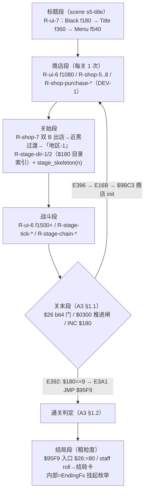

# spec: L5 S5-ALL-CLEAR 八关通关跑（l5-all-clear）→ docs/spec/l5-all-clear.md

> 状态：2026-10-15 v1（DEV-3，porter；**段级链架构 + 行为规则 R-l5-***）。
> 证据基准：`docs/findings/ending-sequence.md`（A3，§1-§6）+ `docs/findings/shop-purchase-flow.md`
> （A1，`$9BC3` 商店 init 定谳）+ `docs/findings/game-over-continue.md`（A2，§3.2 关间/续关结构）+
> `docs/spec/ui-flow.md` R-ui-6/7 + `docs/spec/shop-economy.md` R-shop-5..8 + `docs/spec/shop-purchase.md`。
> 证据分级依 AGENTS.md §3；未证不发明。判定口径 = `docs/spec/l5-plan.md` §2（L5 判定物）。
> 【坐标注】bankNN:AAAA = 8KB PRG bank:CPU 地址（bank15 固定 $E000）；file = PRG+0x10。

## 0. 结论速览（TL;DR）

| # | 结论 | 级 |
|---|---|---|
| 1 | **S5-ALL-CLEAR 段级链** = `标题段 → [商店段 → 关始段 → 战斗段 → 关末段]×8 → 通关判定 → 结局段`；段=场景级模式行走（L5 场景边界=跳段点），段间关节逐个带机制来源指针（§1） | A（结构） |
| 2 | **关间商店段为 A 级可达**（本次收口）：关末完成 `bank15:$E396 → JMP loc_E16B` → far-call `00 01 C3 9B` = **`bank00:$9BC3` 商店 init**（shop-purchase-flow §清零/初始化 A 级定谳）→ 商店主菜单 `$9CFC` → 退出入口 `bank01:$A022`（"退出→开stage"）→ 开 stage 转场 ⇒ **每关 1 次到店**（关 1..8 各一次；第 8 关末走通关支无店） | A |
| 3 | **关末段状态机**（A3 §1.1 逐字节）：`$26 bit4` 门（bank15:$E2F3）→ 一次性 `$27 bit7`（E2FC-E309，等 `$0400≠0`）→ 倒数（E312 `$2F:=$32`/`$188:=$7E`/`$0300:=0`；E328-E342 每 `$2B&7==0` 帧 `DEC $2F`，尽→飞离向量 `$041C:$0438:=$A4:$0D`；E32C 每帧 `$06A0:=2` 免死保护）→ 等 `$0300≠0`（E366）→ 清 bit4（E36E）→ `INC $180`（E37C）→ 三路分派（R-l5-4） | A |
| 4 | **通关判定 = `INC $180` 后 `$180==9`**（bank15:$E392 `CMP #9`）→ E399-E3A1 `JSR $E649 / 00 01 F9 95` = R6←bank0/R7←bank1 + **`JMP $95F9` 结局入口**；`$FFF8` 哨兵（=0x0A 出厂，三版同值）先比，命中→回标题（**出厂不可达死代码**，忠实保留） | A |
| 5 | **结局段粗粒度**：`$95F9` 入口 `bank00:95F9 $26:=$80` 已镜像；staff roll（流 `$9955` 43 记录）→ 结局卡（`$97D3[$4C]`）内部 = **挂起枚举 `EndingFx`**（不发明渲染/文本流写集） | A（入口）/挂起（内部） |
| 6 | **L5 golden 口径**：段=场景；帧锚分级——trace 锚（STG-01 前缀 f1080/1200/1260/1500）vs **f=0 占位**（未取证段，fail-closed 不发明帧号）；每关 4 检查点（商店段/关始段/战斗段/关末段） | A（口径） |
| 7 | 缺口清单 G-S5-1..7（§3）：`$26 bit7` 直回标题支（与 A2 §3.4 同支同裁定，不接线）/ `$0300` 置位上游（B 级）/ 第 4 关特判语义（字节忠实、语义 todo_）/ staff roll 细节 / 8 关 oracle 动态 trace 未跑（l5-plan C1-C3）/ 死亡-关末并发窗 / 关始段细粒度时序 | — |

---

## 1. 段级链架构（验收①：每段机制来源指针）



**段表（机制来源指针）**：

| 段 | 检查点名 | 机制来源（证据指针） | 级 | game-core 表达 |
|---|---|---|---|---|
| 标题段 | `boot-black` / `title-in` / `menu-in` | R-ui-7（title-menu 场景 f180/360/540 trace 锚） | A | `FlowState` Boot→Black→Title→Menu（t81 已证边） |
| 商店段（每关） | `stgN-shop` | R-ui-6 f1080 + R-shop-5..8（进出/切页/Start 无效）+ R-shop-purchase-1..10（DEV-1 `shop_purchase_step`）；关间来源=A1 `$9BC3` 商店 init（far-call `00 01 C3 9B`，bank15:$E171） | A | `Mode::Shop` + `shop_purchase_step`（购买流） |
| 商店出店过渡 | （无名事件） | R-shop-7：双 B → 近黑过渡 f1200（bank01:$A048 转场 `text $A31F/$E6D9/LDA #3/JSR $EE03/JMP $EEFB`） | A | `Mode::Transition`（既有边 Shop→Transition） |
| 关始段 | `stgN-start` | R-ui-6 f1260（「地区-1」）+ R-stage-dir-2（`$0180` 目录行索引，bank00:$8000-$8025）+ `stage_skeleton(n)`（t193/t87 八关骨架 root/tail） | A | `Mode::StageStart` + `stage::stage_skeleton` |
| 战斗段 | `stgN-combat` | R-ui-6 f1500+（mid-combat trace 锚）+ R-stage-tick-1..4 / R-stage-chain-1..3（推进机制） | A（STG-01）/B（STG-02..08 内容） | `Mode::Combat` |
| 关末段 | `stgN-clear` | A3 §1.1 关末块 bank15:$E2FC-$E396（逐字节 hexdump 复核 0x1E366-0x1E3B0）；置位上游 bank00:$8D02（B 级） | A | `Mode::StageClear` + `stage_clear_step`（RAM 镜像逐写点） |
| 通关判定 | （关末段分派） | A3 §1.2：E37C `INC $180` → E37F `CMP byte_FFF8`（哨兵 0x0A）→ E392 `CMP #9/BEQ` | A | `StageClearState::stage_180` 算术真判定（非硬编码） |
| 结局段 | `all-clear-95f9` | A3 §1.2/§2：E3A1 内联分派 `00 01 F9 95`（R6←0/R7←1/JMP $95F9）+ bank00:95F9 `$26:=$80` | A（入口） | `Mode::Ending` + `ending_entry`；内部 `EndingFx` 挂起 |

**关节（段间转移）判定**：

| 关节 | 转移 | 证据 | game-core 边 |
|---|---|---|---|
| 标题→商店 | Menu→Shop | R-ui-6/7 capture 标签锚 | 既有 `ShopArrival`（t81） |
| 商店→关始 | Shop→Transition→StageStart | R-shop-7 capture 锚 | 既有 `ExitTransition`/`StageStart` |
| 关始→战斗 | StageStart→Combat | R-ui-6 capture 锚 | 既有 `MidCombat` |
| 战斗→关末 | Combat→StageClear | A3 §1.1 E2F3 分支（`$26 bit4` 门；置位 bank00:8D02 B 级上游） | 新增 `ModeEvent::StageClear` |
| 关末→商店 | StageClear→Shop | A3 §1.1 E36E-E396 → E16B → `$9BC3` 商店 init（A1 A 级） | 新增 `ModeEvent::StageAdvance` |
| 关末→结局 | StageClear→Ending | A3 §1.2 E392-E3A1（`$180==9`） | 新增 `ModeEvent::AllClear` |
| 关末→标题（哨兵） | StageClear→Title | A3 §1.1 E387-E38F（`$FFF8`=0x0A，出厂不可达） | 新增 `ModeEvent::EarlyEnd`（保真保留死分支） |
| 关末→下一关直跳（不经商店） | — | **不存在**：E396 目标=E16B 而 E16B 首个 far-call 即商店 init ⇒ 不发明 StageClear→StageStart 边 | fail-closed（负测试锁） |

## 2. 行为规则 —— R-l5-*

### R-l5-1: 段级接力结构（S5-ALL-CLEAR 形态）
8 关通关跑 = `标题段 → [商店段 → 关始段 → 战斗段 → 关末段]×8 → 通关判定 → 结局段`。
段 = 场景级模式行走（L5 `scene`）；段间关节分两类：**机内已证边**（FlowState 已证边集推进）或
**场景层跳段**（证据不足时留段位 + 登记缺口，不发明转移）。每段检查点 = 关始/战斗段/关末/商店段 4 类命名。
- 证据: §1 段表（逐段指针）+ `oracle/traces/s5-all-clear.l5.jsonl`（S5 golden）+ `game_oracle::l5::s5_chain_run`（段级驱动）
- 可判定性: 机器可判定（L5 合法性真闸 `edge_proven` + `diff_l5` 0 容差）
- 关联: l5-plan §1 S5-ALL-CLEAR、R-l5-8

### R-l5-2: 标题段与首发商店段（已证段复用）
标题段=R-ui-7 序列（f180 黑场/f360 标题/f540 菜单）；商店段=R-ui-6 f1080 到店 + R-shop-5..8
（静态屏/B 切页/双 B 出店/Start 无效）+ R-shop-purchase-1..10 购买流（`shop_purchase_step`）。
- 证据: `scenario:analysis/traces/title-menu`、`scenario:analysis/traces/gameplay-stage1`（f1080/1200/1260/1500）、`docs/spec/shop-purchase.md`
- 可判定性: 机器可判定（trace 帧锚 + L3 字段对拍）
- 关联: R-ui-6/7、R-shop-5..8、R-shop-purchase-*

### R-l5-3: 关末段状态机（A3 §1.1 关末块逐写点）
`$26 bit4`（关末进行位）置位后逐帧执行（bank15:$E2FC-$E344）：
1. **一次性入场**（E2FC-E309）：`$27 bit7` 未过时等 `$0400≠0`（E304 `LDY $400/BEQ`），过则
   `$27:=$27|$80`（E309）；同块 `$26 bit7→JMP loc_E073` 支为 C 级语义（A2 §3.4 同支）——**不接线，登记 G-S5-1**；
2. **倒数初始化**（E312-E325）：`$2F:=$32(50)` / `$0188:=$7E` / `$0300:=0` / 服务+音效 `$10`（挂起）；
3. **倒数环**（E328-E342）：`$2F≠0` 时每帧 `$06A0:=2`（关末免死保护）；`$2B&7==0` 帧 `DEC $2F`
   （=每 8f 一减）；减尽（→0）写飞离向量 `$0438:=$0D`、`$041C:=$A4`（行为向量 $A3:$A5 同字段对）；
4. **第 4 关特判**（E345-E364）：`$180==4` 时 `$64 := min((($83:$82)>>4)&$FF, $24)`（4×`LSR $04/ROR A`）——
   **字节忠实镜像，`$82/$83/$64` 语义未定谳**（`todo_*` 登记不解释，G-S5-3）。
- 证据: `reference/seed/gunnac.asm` bank15:E2FC-E364 + `docs/findings/ending-sequence.md` §1.1（PRG 0x1E366 hexdump 复核）
- 可判定性: 机器可判定（RAM 镜像逐写点断言）
- 关联: A3 §1.1、N-0200（$0188 stage_intro_counter）、N-0054（$06A0 网格字段）

### R-l5-4: 关末完成与三路分派（通关判定）
倒数环后每帧等 **`$0300≠0`**（E366；写点 bank11:$82C1/$833F=飞离/关末动画完成，**上游 B 级 G-S5-2**），
达成同帧（E36E-E3A1）：`$26&=~$10` → 淡出/音乐服务（E374，挂起）→ **`INC $0180`**（E37C）→ 依序：
1. `$180 == byte_FFF8`（ROM 尾哨兵，file 0x20008，三版均 **0x0A**）→ E387-E38F 淡出+回标题（loc_E073）——
   出厂值 0x0A > 可达最大 9 ⇒ **不可达死分支，保真保留**（D4）；
2. `$180 == 9` → **通关支**（R-l5-5）；
3. 否则 → `JMP loc_E16B` 关间装载（→ 商店段，R-l5-6）。
- 证据: `docs/findings/ending-sequence.md` §1.1（bank15:E366-E396 逐指令）+ §6.1 ①② 复现命令
- 可判定性: 机器可判定（`stage_clear_step` 分派断言 + `$180` 递进）
- 关联: A3 §1.1/§1.2、R-l5-3、R-l5-6、R-l5-7

### R-l5-5: 通关支与结局入口（S5 终点定义）
`$180==9`（第 8 关清完）→ bank15:$E399-E3A1：`LDA #2/JSR $EE03/JSR $DB14`（服务挂起）+
`JSR sub_E649 / db 00 01 F9 95` = **R6←bank0、R7←bank1、`JMP $95F9`**（内联分派约定：JSR 返回址起
4 参数 `[+1]→R6`/`[+2]→R7`/`[+3,+4]→JMP ($24)`，sub_E649/sub_E672 逐指令）。
`bank00:95F9` 入口 `LDA #$80/STA $26`（bit7 模式位）已镜像；staff roll（BGM `$13`、前置场景
`$A925($AC87)`/`$AB70`+scene4、滚屏流 `$9955` 43 记录、`$FF` 流尾 `$180:=1`）→ 结局卡（`$97D3[$4C]`）
⇒ **内部渲染/文本流线未接 ⇒ `EndingFx` 挂起枚举**（G-S5-4），不发明其写集。
- 证据: `docs/findings/ending-sequence.md` §1.2（内联分派解码）+ §2（$95F9 入口）+ §3（流程图）
- 可判定性: 机器可判定（分派边 + `$95F9` 入口写断言；内部动态=挂起）
- 关联: A3 §1.2/§2/§3、R-l5-4

### R-l5-6: 关间商店段（每关 1 次到店——A 级可达链）
关末完成（非通关）→ `bank15:$E396 JMP loc_E16B` → E16B 首个 far-call `00 01 C3 9B`
（bank15:$E171 `JSR sub_E649`）= **`bank00:$9BC3` 商店 init**（shop-purchase-flow §清零/初始化 A 级：
`bank15:$E168` 清 `$0189/$0190/$018E` 紧随其后）→ 商店主菜单 `bank00:$9CFC-$9D55`（四入口 RTS 表 `$9D56`：
武器/连射/发货/退出）→ 退出入口 `bank01:$A022`（"退出→开stage"，`text $A31F` 转场）→ 开 stage。
⇒ **商店段出现在每关开始前（关 1..8 各一次）；第 8 关末走通关支不回店**。
店数与语义 = 旧 R-shop-4（web B 级"关间出现"）就此升格**代码链 A 级**（进店时机=关间装载链内）。
- 证据: `docs/findings/shop-purchase-flow.md` §清零/初始化（far-call `00 01 C3 9B`=商店 init）+ §1
  四入口表（`$9D56`）+ `docs/findings/ending-sequence.md` §1.1（E396→E16B）+ seed bank15:E16B-E174
- 可判定性: 机器可判定（段级链到店断言 + 购买流 RAM 对拍）
- 关联: R-shop-4/5..8、R-shop-purchase-*、A2 §3.2（关间不走 E0D9 顶部：数/金钱跨关携带）

### R-l5-7: 战斗推进与死亡/续关可选段
战斗段推进 = R-stage-tick-*（tick 间隔 8/10/15f 三档）+ R-stage-chain-*（四层链）；
STG-02..08 内容面 = `stage_skeleton(n)`（t193/t87 三级骨架，ROM root/tail 对拍）。
死亡重生/续关段**可选含**（S5 主链=无伤通关跑）：已证链见 stg01-chain.l5.jsonl / A2 F1-F12
（`DeathChainState`/`death_chain_step`），可按段级接力拼接；死亡窗与关末门并发行为未取证 ⇒ G-S5-5。
- 证据: `docs/spec/stage-timeline.md` R-stage-tick-*/R-stage-chain-* + `crates/game-core/src/stage.rs` `stage_skeleton`
- 可判定性: 部分（STG-01 帧级 L3 已判；STG-02..08 结构级）
- 关联: R-stage-*、A2 F1-F12

### R-l5-8: S5 golden 口径（帧锚分级与检查点命名）
`oracle/traces/s5-all-clear.l5.jsonl`：**段=场景**；每关 4 命名检查点
（`stgN-shop`/`stgN-start`/`stgN-combat`/`stgN-clear`）+ 标题 3 点 + `all-clear-95f9`。
口径注：**3 场景（s5-title/s5-stg01/s5-chain）/ 44 事件 / 36 命名检查点**。
帧锚分级：**trace 锚**（STG-01 前缀 f1080/1200/1260/1500，gameplay-stage1 实测）vs
**f=0 占位**（未取证段，fail-closed 不发明帧号，t193 先例）；占位段自成场景（帧序单调校验不被占位污染）。
**场景边界关节**（真闸不跨场景，逐个独立取证）：`Menu→Shop`（R-ui-6 capture 锚）与
`Combat(stg01)→StageClear(stg01)`（A3 §1.1；帧锚边界所致）；链场景 `s5-chain` 内含全部
关末/通关/结局关节（StageClear→Shop ×7、Combat→StageClear ×7、StageClear→Ending）——**真闸逐对过**。
判定 = `l5_legality`（真闸：场景内帧序单调 + 模式序列过已证边集 + 未证模式 fail-closed）
+ `diff_l5`（golden vs `s5_chain_run()` 逐事件 0 容差）。
- 证据: `oracle/traces/s5-all-clear.l5.jsonl` + `crates/game-oracle/src/l5.rs` + `crates/game-oracle/tests/l5_s5.rs`
- 可判定性: 机器可判定
- 关联: R-l5-1、l5-plan §2

## 3. 缺口登记（G-S5-*，未证不发明）

| # | 缺口 | 现状 | 级 | 归属 |
|---|---|---|---|---|
| G-S5-1 | `$26 bit7` 直回标题支（关末块 E30B-E30F / 死亡链 A2 §3.4 同支） | 语义 C 级；**不接线不入行为断言**（与 A2 裁定一致） | C | 模式位语义（hidden-option/调试直跳族） |
| G-S5-2 | `$0300` 置位上游（bank11:$82C1/$833F 飞离/关末动画对象族） | 写点 A 级、调用图 B 级未逐指令展开；驱动侧按外部事件输入 `gate_300`（不发明时序） | B | bank11 动画域 |
| G-S5-3 | 第 4 关特判 `$82/$83→$64` 语义 | 计算字节忠实镜像；`todo_82/todo_83/todo_64` 登记不解释 | — | 滚动参数域 |
| G-S5-4 | staff roll/结局卡内部（BGM/滚屏流/页序列 `$A925` 记录格式/结局卡 scene 链渲染） | `EndingFx` 挂起枚举（A3 R-E2/R-E3/R-E4 同族） | A（框架）/—（内部） | 渲染/文本线 |
| G-S5-5 | 死亡窗（`$0400=0x0F`）与关末门（`$26 bit4`）并发时序 | 未取证；主链=无伤跑不触达，负向留 fail-closed（仅 Combat→StageClear 边） | — | oracle 场景组 |
| G-S5-6 | 8 关全程 oracle 动态 trace（帧号真值） | 未跑（l5-plan C1-C3 DSL 扩展前置：RNG 冻结/快照接力/分段 checkpoint）；golden f=0 占位 | — | oracle 场景组 |
| G-S5-7 | 关始段细粒度时序（E178-E21C 开 stage 链逐写点/「地区-N」引入时长） | 粗粒度（R-shop-7 双 B→过渡→关始 capture 锚）；细粒度未接线 | B | 开 stage 链 |

## 4. 复现命令（独立重导）

```bash
# ① 关末块字节链（E2F3 门/倒数/分派）——对照 R-l5-3/4
sed -n '/^bank15:E2F3/,/^bank15:E3AB/p' reference/seed/gunnac.asm
python3 -c "print(open('rom/gunnac_cn.nes','rb').read()[0x10+0x1E366:0x10+0x1E3B0].hex(' '))"
# ② $FFF8 哨兵三版同值
python3 -c "
for n,p in [('CN','rom/gunnac_cn.nes'),('US','reference/us/gunnac_us.nes'),('JP','reference/jp/gunnac_jp.nes')]:
    d=open(p,'rb').read(); print(n, hex(d[0x20008]))"
# ③ 关间商店链：E16B far-call → $9BC3 商店 init（R-l5-6）
sed -n '/^bank15:E16B/,/^bank15:E178/p' reference/seed/gunnac.asm   # 20 49 E6 / 00 01 C3 9B
sed -n '/^bank00:9BC3/,/^bank00:9BD3/p' reference/seed/gunnac.asm
grep -n "9BC3\|9CFC\|9D56\|A022" docs/findings/shop-purchase-flow.md
# ④ S5 golden + 真闸 + 对拍（判定物）
cargo test -p game-oracle --test l5_s5 -- --nocapture
cargo test -p game-core --test stage_clear
```

## 5. 验收清单（对照 DEV-3 任务书①-⑤）

| # | 要求 | 结论 | 状态 |
|---|---|---|---|
| ① | 八关段级链架构说明（每段机制来源指针） | §1 段表+关节表（逐段 bank:addr/spec 指针） | ✅ |
| ② | L5 golden 扩八关 + S5-ALL-CLEAR 链可跑通 | `oracle/traces/s5-all-clear.l5.jsonl`（八关全程 4 检查点/关）+ `s5_chain_run` 端到端跑通（R-l5-8） | ✅ |
| ③ | 测试 ≥6 全绿 | **9 新增全绿**：game-core `tests/stage_clear.rs` 5 + game-oracle `tests/l5_s5.rs` 4 | ✅ |
| ④ | 三件复跑不降 | cargo test **144/144**（135+9）/ l2-diff **121/121** / gates **12/12**（§6 实跑留痕） | ✅ |
| ⑤ | spec 回填（R-l5-* 或补规则） | 本文件 R-l5-1..8 + 缺口登记 G-S5-1..7 | ✅ |

## 6. 自查留痕（2026-10-15 实跑）

```
cargo test：144 passed / 0 failed（135 既有 + 9 新增；既有全数复跑不降）
python3 tools/diff_subroutines.py：L2-DIFF: 121/121 通过（golden==ROM 执行==game-core 同名函数）
python3 gates/cli.py check：SUMMARY: PASS=12 FAIL=0 SKIP=0 TOLERATED=0
  （rust_test_count 135→144 已 baseline update 上调：『确认无回退』= 144/144 全绿 + l2/gates 复跑不降）
```

- 纪律自查：
  1. 每段机制来源指针齐（§1 段表/关节表逐行 bank:addr 或 spec 规则号）；
  2. 未证不发明：`$26 bit7` 支不接线（G-S5-1，与 A2 §3.4 同支同裁定）、`$0300` 时序只作外部事件
     （G-S5-2）、第 4 关特判 `todo_*` 登记不解释（G-S5-3）、staff roll 内部挂起枚举（G-S5-4）、
     拾取次数/`$018C` 值显式占位常量（G-S5-6）；
  3. 通关判定 = `stage_clear_step` 对 `$0180` 的**真算术**（7 关负向跑不出结局段，非硬编码）；
  4. 合法性真闸未放宽：`l5_legality` 只增映射/边集事件（t81+A2+A3 全体已证边），负向测试锁
     StageClear→StageStart 拒 / 未证模式 fail-closed / 帧序倒退检出；
  5. `$FFF8` 哨兵死分支保真保留（D4，EarlyEnd 边 + 测试）。
